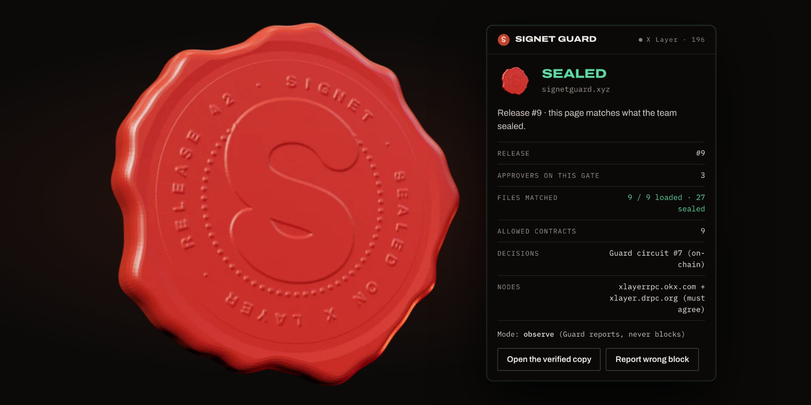

# Signet: the website can only ask your wallet for what its team sealed on X Layer



A dApp team seals each release of its website on X Layer; no single key can publish a release.
Users with the Guard extension can't sign anything the team didn't approve.
It's live on mainnet: [signetguard.xyz](https://signetguard.xyz) runs on it, and [`/prove`](https://signetguard.xyz/app#/prove) checks it from your browser, with no wallet.


[](https://github.com/kenil1710/signet/actions/workflows/test.yml) Contracts verified on [Sourcify](https://repo.sourcify.dev/196/0x98dB5B6B1545D0fb374da40a02045B93398E0589) (exact match: registry, factory, ReleaseGate implementation; `docs/verify/`).

> **Judges: start with [`JUDGES.md`](JUDGES.md)** (5 minutes: what to check, in order, with links). Machine-readable: [`claims.json`](claims.json), [`llms.txt`](llms.txt).

**Your contracts are audited. Your website isn't.** Signet protects what your users actually load: no single key can publish a release of your site, a hacked host or DNS is detected within minutes and blocked for users with Signet Guard, and those users can't sign anything your team didn't approve.
**What teams get:** release approvals with on-chain timelocks (CI only proposes, approvers approve in their own wallets, TapeOut circuit #6 decides), watchtower alerts, a freeze any one approver can pull at once, a verified copy read from X Layer (built; live with Pro), and a public proof and badge. **For users:** Guard **blocks the signature** to any contract or spender the team didn't approve (circuit #7), and in enforce mode refuses `eth_sign` and any signature it can't read (Guard 0.3.5). Signet **builds on TapeKit's** on-chain file verification.
**What it is.** A dApp team seals each release of its website on X Layer; a TapeOut circuit decides when it may go live, and users who run the **Guard** extension get every page and every signature checked against it by a second TapeOut circuit.
**Benchmark (12 attacks we wrote, on our own local fork of X Layer):** SRI alone blocks 2, Signet Guard with its signature checks switched off ("hash-only") 7, **Signet 12**, with **0 false blocks** ([`docs/benchmark.md`](docs/benchmark.md)).
**Verify it yourself:** `pnpm install && pnpm verify:claims` (read-only, about 2 minutes, checks [`CLAIMS.md`](CLAIMS.md) against X Layer mainnet).
**Live site:** https://signetguard.xyz (landing page, [dashboard](https://signetguard.xyz/app), [`/prove`](https://signetguard.xyz/app#/prove) against mainnet with no wallet, [setup guide](https://signetguard.xyz/start)). **CLI:** `npm install -g signetguard` ([npm](https://www.npmjs.com/package/signetguard)). Run everything locally: [`docs/TRY-IT-LOCALLY.md`](docs/TRY-IT-LOCALLY.md). License: MIT ([`LICENSE`](LICENSE)).
**On mainnet** ([`docs/mainnet.md`](docs/mainnet.md)): release-policy circuit **#6** and Guard decision circuit **#7** on processor #101 `0x73153e5fd2Acac604D49d6ca9fea27b750718F22`; SignetRegistry [`0x98dB5B6B…0589`](https://web3.okx.com/explorer/x-layer/evm/address/0x98dB5B6B1545D0fb374da40a02045B93398E0589), SignetFactory [`0xc5e12ffe…7986`](https://web3.okx.com/explorer/x-layer/evm/address/0xc5e12ffe9D5bE7085441bD955724A6FAff9f7986), Signet's site gate for `signetguard.xyz` [`0xa3d4dfb5…4503`](https://web3.okx.com/explorer/x-layer/evm/address/0xa3d4dfb5fB47D2CcF9b4a0a0fcC64Ac3fFef4503), in **enforce** mode since 2026-11-25. misthos.world (the team's own app) published release #1 on 2026-11-25 and is in observe mode until its team switches (possible from 2026-12-01). Neither gate has a guardian ([`THREAT_MODEL.md`](THREAT_MODEL.md), "Signet's own keys").
**Honest limits:** users without Guard are not protected at signing; the watchtower alerts their team instead. A stolen hosting or DNS credential can still change what visitors load: Signet detects it and refuses Guard users, it doesn't prevent it ([`THREAT_MODEL.md`](THREAT_MODEL.md)).
**Tests:** CI runs 173 Foundry tests (the 17 fork tests need an X Layer RPC: `cd packages/contracts && XLAYER_RPC_URL=https://xlayerrpc.okx.com forge test` runs all 190), both circuits on all 512 inputs and every package's unit tests. The staging and attack suites run on a local fork ([`docs/TRY-IT-LOCALLY.md`](docs/TRY-IT-LOCALLY.md)).

---

## What is in this repo

| Package | What it does | Status |
|---|---|---|
| `packages/circuit` | Release-policy circuit (34 NAND) and Guard decision circuit (22 NAND), reference functions, exhaustive 512-row tests | both on mainnet (#6, #7) |
| `packages/contracts` | ReleaseGate (one per project), SignetRegistry (domains, enumerable list, chunked file writes), SignetFactory | 190 Foundry tests (CI runs 173; the 17 fork tests need an RPC); on mainnet |
| `packages/cli` | `signet` CLI: init, verify, seal, propose, diff (Diff Guard), approve, publish, upload, wait, freeze | on npm (`signetguard`); used for every mainnet release |
| `packages/action` | GitHub Action: verify, seal, propose, publish when the circuit allows, then deploy | staging (local runner) |
| `packages/extension` | Guard (Chrome MV3): page check from the browser cache, signing check decided by the Guard circuit | signed pre-release zip on GitHub (mainnet build); not in the Web Store |
| `packages/gateway` | The verified copy as a normal web page, every file checked against the sealed hashes | staging; not deployed |
| `packages/dashboard` | Landing page, projects, proposals with Diff Guard, approvals, freeze/revoke, `/prove`, badge | live on Cloudflare Pages, reading mainnet |
| `packages/watchtower` | Loads each watched site, alerts the team on a mismatch confirmed by two loads | live for signetguard.xyz (not misthos.world yet): every 5 minutes, started by a Cloudflare Worker cron (it runs on GitHub Actions; GitHub's own schedule ran every 4–12 hours and is only a fallback); status and its last `/prove` run at `/prove`; Telegram alerts set up (test alert accepted 2026-11-20) |
| `packages/attacks` | The attack suite and the benchmark | staging |

## Protect your own site

```bash
npm install -g signetguard     # the signet CLI: one file, Node 18+, no repository needed
```

Then follow the five steps at [`/start`](https://signetguard.xyz/start): create your gate in the dashboard, prove
your domain (`signet domain public`), add the GitHub workflow, approve your first release.

## Built on TapeOut: what Signet really uses

Everything below is on X Layer mainnet (chain 196) unless it says otherwise. `pnpm verify:claims` checks the
on-chain parts (C1–C9 in [`CLAIMS.md`](CLAIMS.md)).

| TapeOut part | How Signet uses it | On mainnet |
|---|---|---|
| **Circuit #6** on processor **#101** [`0x73153e5f…8F22`](https://web3.okx.com/explorer/x-layer/evm/address/0x73153e5fd2Acac604D49d6ca9fea27b750718F22): release policy, 34 NAND, 9 inputs, 2 outputs | ReleaseGate calls `processor.eval(6, …)` **inside every publish and unfreeze transaction**: the circuit's PUBLISH / UNFREEZE output decides. A Solidity copy of the same gates decides only if the call fails or returns a malformed answer (see below). Truth table: [`docs/policy-truth-table.md`](docs/policy-truth-table.md) | Taped out 2026-11-16 (mint [`0x1c772cbe…`](https://web3.okx.com/explorer/x-layer/evm/tx/0x1c772cbe1cfeded533308f7fb3be7a07338144754d8d95205359efef0ff6b1be), tape-out [`0x354cb0d5…`](https://web3.okx.com/explorer/x-layer/evm/tx/0x354cb0d5e93245326e19cab3c701d5b6b72122d6e293c96f6d7b2211a4f82b96)); 512/512 rows verified on 2 RPCs |
| **Circuit #7** on processor #101: Guard decision, 22 NAND, 9 inputs, 3 outputs | Guard asks it for ALLOW / WARN / BLOCK on every signature, with an `eth_call` to `eval`. A local mirror is used if the stored netlist isn't the reviewed one. Truth table: [`docs/guard-truth-table.md`](docs/guard-truth-table.md) | Taped out 2026-11-18 (mint [`0xa655247a…`](https://web3.okx.com/explorer/x-layer/evm/tx/0xa655247a48cb08f60d0b3304b3a8d0fea540115b6ed1f5472900f3c793f3b059), tape-out [`0x8fc6a9d7…`](https://web3.okx.com/explorer/x-layer/evm/tx/0x8fc6a9d7dbf6082783b267449ee13c6327af56f2a662e087f23f1c40ade44c16)); 512/512 verified |
| **Circuit Container** of circuit #5 [`0x8E2E14Ac…94Ed`](https://web3.okx.com/explorer/x-layer/evm/address/0x8E2E14Ac2B8EfAB942d2dAEbe232071460bA94Ed) + **SiteRegistry** [`0xd6EFb7ad…ADB6`](https://web3.okx.com/explorer/x-layer/evm/address/0xd6EFb7adCc9c83dC4924Ad56f6a8E4e969b9ADB6), the storage DeWEB sites live in | Each release's sealed manifest (`signet/files.json`, `allowlist.json`, `origins.json`) and the files of the **verified copy** go here, under `projects/<domain>/` (Signet's own site: `signet/<domain>/`). [SignetRegistry](https://web3.okx.com/explorer/x-layer/evm/address/0x98dB5B6B1545D0fb374da40a02045B93398E0589) is the container's SiteRegistry **operator** (a 30-day grant) and writes only files that the domain's gate approved in a release | Container opened, and a test file written and read back (Spike B, C6). Circuit #5 is held by Signet's site gate; the registry is the operator until 2026-12-19, renewable by anyone. Each release stores its manifest; release #8's 29 files are stored in full |
| **Chunked writes** (`SiteRegistry.appendChunk`) | `SignetRegistry.writeChunk` stores files over 48,000 bytes as 24,000-byte pieces, one proved piece per transaction, so a real bundle fits under the per-transaction gas limit | Deployed in the registry. Measured on a mainnet fork: a 300 KB bundle = 13 transactions, ≈ 0.0015 OKB (R10) |
| **TapeKit / TAP-10 reading rules** | Guard, the gateway, the watchtower and `/prove` read files with `SiteRegistry.read` and accept one only if its size and SHA-256 equal the on-chain record ([TAP-10 §7.1](https://github.com/TapeOutProtocol/TAPs/blob/main/TAPs/TAP-10.md)). Chain facts are read from **two independent RPCs that must agree**, as TapeKit does. The verified-copy gateway reuses [TapeKit's service-worker gateway](https://github.com/TapeOutProtocol/TapeKit/tree/main/sw-gateway) design (our own code, with Guard pinning its files) | The rule runs against mainnet in `/prove`. The gateway is staging-only |

Not used yet (see the Roadmap): TapeSend, TapeCode, hosting the site itself on DeWEB.

**Where the publish decision is made.** On every publish and unfreeze, ReleaseGate calls circuit #6 (`processor.eval(6, …)`) and its PUBLISH / UNFREEZE output decides. A Solidity copy of the same 34 gates (equal on all 512 inputs, checked in CI) decides only if that call reverts or returns a malformed answer, or if the circuit's beacon implementation is no longer the one pinned when the gate was made (which can't happen while the beacon has no owner); each fallback emits an event (`PolicyFallbackEvalFailed`, `PolicyFallbackBeaconChanged`). **Why a circuit:** its beacon has no owner, so the rule's logic can't be upgraded by anyone, including us, and a gate can only ever switch to another copy of the same netlist (a tier-11 change). A team can change its approvers and its waits (10 min to 5 days), only through tier 11; nobody can change the rule itself.

### The four risk tiers

| Tier | What changed (computed on-chain from the release's hashes) | To publish |
|---|---|---|
| 00 | Code only | 1 approval + 1 h, or 3 of 3 with the emergency flag |
| 01 | A new external origin, or a changed SRI hash of a cross-origin script | 2 approvals + 1 h |
| 10 | A new contract or spender. **Every team's first release is tier 10** | 2 approvals + 24 h, or 3 of 3 with the emergency flag |
| 11 | Admin: approvers, timelocks, domain binding, circuit copy | 3 of 3 + 24 h, no fast lane |

Frozen: nothing publishes. Any one approver can freeze; unfreezing needs 2 of 3. The 1 h / 24 h waits are defaults.

## Why not just GitHub?

GitHub's required reviews and deployment environments (required reviewers, a wait timer) approve code **before**
it deploys; use them. The big front-end attacks happened **after**: a file swapped on the hosting (Bybit /
Safe{Wallet}), a script injected through the CDN (BadgerDAO), a poisoned npm package (Ledger Connect Kit), a hijacked
domain (Curve, CoW Swap). GitHub never saw any of them.

| | GitHub (reviews, environments) | Signet |
|---|---|---|
| Approvals before deploy | Yes: required reviewers (one approval is enough) and a wait timer; on Free, Pro and Team plans for public repositories | Yes, on X Layer, more approvals and a longer wait for riskier changes |
| A compromised admin | Administrators can bypass the rules by default, and can change them | No admin can skip circuit #6; changing approvers or waits takes 3 of 3 + 24 h, in public. Safety actions are fast on purpose: one approver can freeze or revoke at once |
| Attacks after deploy (hosting, CDN, domain) | Not visible | The watchtower and Guard compare the live files with the seal |
| Alerts when the live site changes | No | The watchtower |
| Users can verify what they load | No | Guard, `/prove`, the badge |
| Blocks the signature to an unapproved contract | No | Guard |
| A public, permanent record | Logs visible to your organization | Every release and approval on X Layer |

Sources: GitHub Docs, [deployments and environments](https://docs.github.com/en/actions/reference/workflows-and-actions/deployments-and-environments) and [protected branches](https://docs.github.com/en/repositories/configuring-branches-and-merges-in-your-repository/managing-protected-branches/about-protected-branches) (checked 2026-11-19).

## How is this different from TapeKit, Code Verify, WEBCAT or WAICT?

[Meta Code Verify](https://engineering.fb.com/2022/03/10/security/code-verify/) checks that WhatsApp Web's code
matches the hash Meta publishes to Cloudflare. [WEBCAT](https://github.com/freedomofpress/webcat) (Freedom of the
Press Foundation; developer preview, Firefox) blocks a page whose assets don't match a manifest signed by the
site's enrolled Sigstore identities.

[TapeKit](https://github.com/TapeOutProtocol/TapeKit) serves DeWEB sites whose files live on X Layer and checks
every file's SHA-256 against the chain. Signet **builds on that verification** (same reading rule, same storage) for
sites that stay on their own domain. [WAICT](https://hacks.mozilla.org/2026/05/trustworthy-javascript-for-the-open-web/)
(Mozilla with Cloudflare, Meta and the Freedom of the Press Foundation, May 2026; a prototype behind a pref in
Firefox Nightly) binds a site's JavaScript to a manifest in a public transparency log.

Signet adds three things for dApps:
- **No single key can publish a release.** CI only proposes; humans approve in their own wallets; an on-chain timelock and
  risk tier (computed from what changed) apply; and a TapeOut circuit whose rule nobody can upgrade decides.
- **A signing-time allowlist.** A wallet is refused contracts and spenders the team didn't seal.
- **A public on-chain record** of every release and approval.

They do some things better:
- WEBCAT is fail-closed before any script runs, and proves domain enrollment with a cooldown. Signet doesn't yet
  (`docs/domain-ownership.md`).
- Code Verify ships at scale.

Details: [`docs/prior-art.md`](docs/prior-art.md).

## Why not just use a scam detector?

Use one: they're complementary. Blockaid (MetaMask's security alerts), Wallet Guard, Pocket Universe and Scam
Sniffer recognize known-bad sites and addresses, and simulate transactions on **any** site. Signet instead
**allowlists** the exact code and contracts a team sealed. That catches a hijack of a **legitimate** site sending
to an address nobody has flagged yet. It protects only sealed sites, and only users who run Guard. Details and a
side-by-side test plan: [`docs/vs-scam-detectors.md`](docs/vs-scam-detectors.md).

## Roadmap (planned, not built)

- **TapeSend alerts.** The watchtower would send alerts ("site doesn't match its seal", "new tier 10/11 proposal",
  "gate frozen") to a team's container inbox through the DeWEB hub `0xe61A…25ee`. The sender would be a relay
  contract holding an opened container, so the server key can only send rate-limited alerts. Measured: ≈ 0.0000039
  OKB per alert. **Waiting on TapeOut** to confirm the hub implementation that was upgraded on 2026-11-18
  (`0xf6b8…9261`, not yet listed in TAP-10).
- **TapeCode sealing (design ready).** TapeCode uploads to a staging container. `signet seal --from-container`
  reads the exact bytes from the chain, the gate's approvals decide, and SignetRegistry copies the approved files
  to production, where TapeCode's key can't write.
- Hosting this site on DeWEB (≈ 0.0044 OKB of storage), the Chrome Web Store listing, and the watchtower in 3 regions.

Research, sources and costs: [`docs/ecosystem-integration.md`](docs/ecosystem-integration.md).

Spec and every decision with its reason: [`docs/signet-spec.md`](docs/signet-spec.md), [`docs/decisions.md`](docs/decisions.md). Built for the X Layer TapeOut Accelerate hackathon. MIT licensed.
